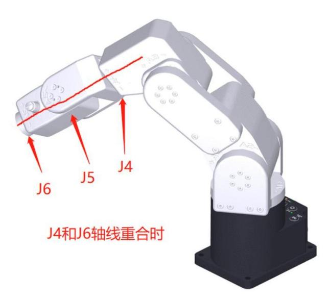
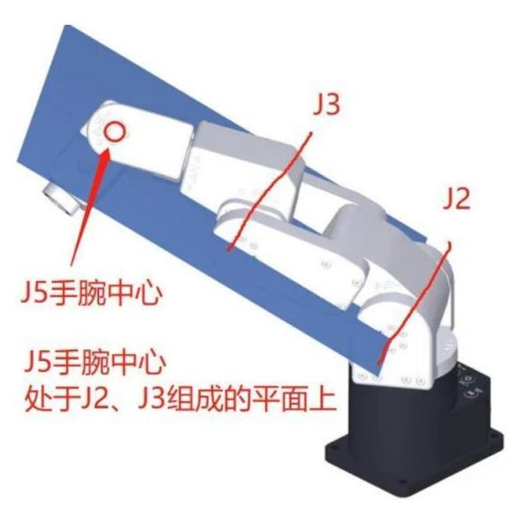
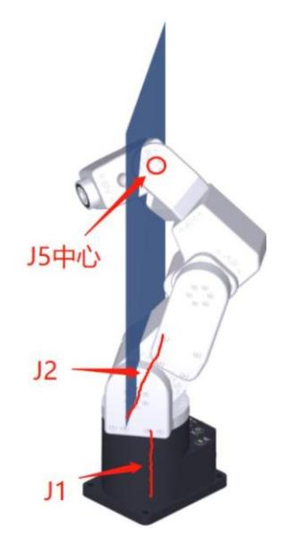
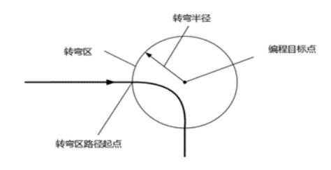
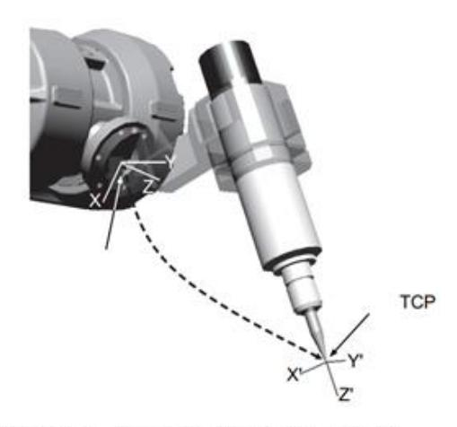
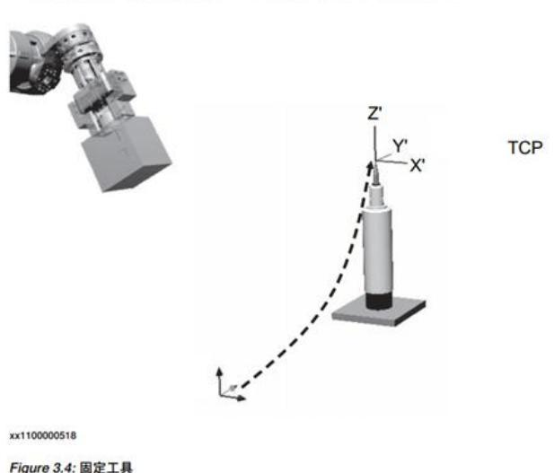
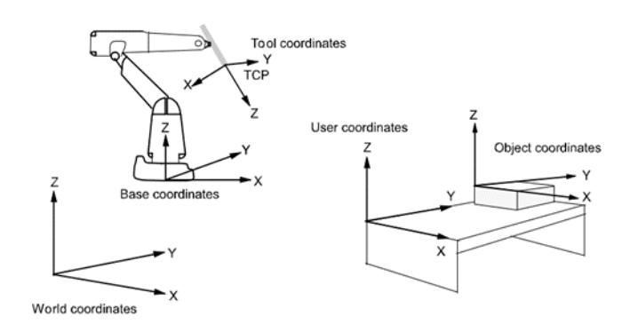
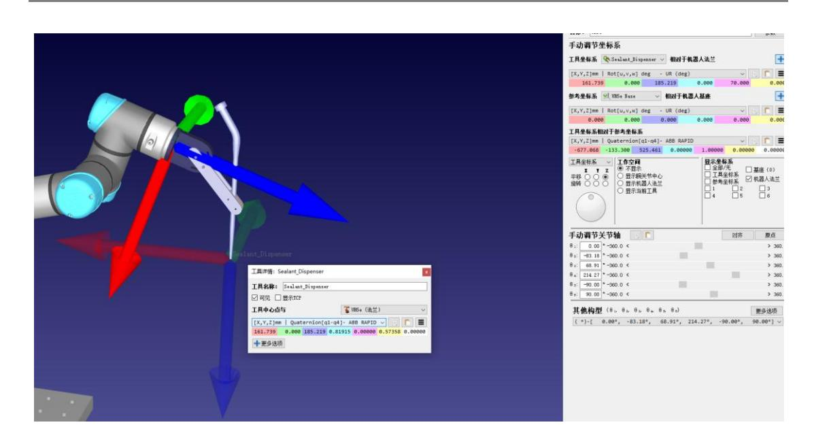
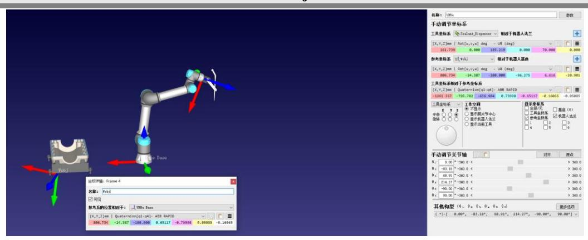

## TRUE贞实科技

AI 赋能控制

# **指令 功能手册 V1.7.4**

## 文档版本

<span id="page-1-0"></span>

| 修订日期                      |
|---------------------------|
| 2025 年<br>08 月<br>21 日    |
| 2025 年<br>08 月<br>30 日    |
| 2025 年<br>09 月<br>18 日    |
| 2025 年<br>10 月<br>14 日    |
| 2025 年<br>10 月<br>28 日    |
| 2025 年<br>12 月<br>日<br>15 |
| 2025 年<br>12 月<br>30 日    |
| 2026 年<br>01 月<br>日<br>16 |
| 2026 年<br>01 月<br>日<br>22 |
|                           |
|                           |
|                           |

## 目录

| 文档 | <b>\版本</b>                    | I    |
|----|-------------------------------|------|
|    | x说明                           |      |
| 常见 | 1奇异点说明                        |      |
|    | 1.Wrist singularity(手腕奇异点)    |      |
|    | 2.Elbow singularity(肘关节奇异点)   | 2    |
|    | 3.Shoulder singularity(肩部奇异点) | 3    |
| →, | 常用变量类型                        | 4    |
|    | 1. load 变量                    | 4    |
|    | 2. jointtarget 关节空间参数         | 4    |
|    | 3. robottarget 笛卡尔空间参数        | 5    |
|    | 4. speed 速度参数                 | 5    |
|    | 5. zone 转弯半径                  | Є    |
|    | 6. tool 工具参数                  | 7    |
|    | 7. wobj 基坐标系参数                | 8    |
| _, | 常用变量指令                        | 9    |
|    | 1. Var 定义变量                   | 9    |
|    | 2. DeleteVar 删除变量             | . 10 |
|    | 3. DisplayVar 打印变量            | . 11 |
|    | 4. ReVarValue 变量重赋值           | . 12 |
|    | 5. DefineParam 定义参数           | . 13 |
|    | 6. DeleteParam 删除变量           | . 14 |
|    | 7. RenameParam 参数重命名          | . 15 |
| 三、 | 基础运动指令                        | . 16 |
|    | 1. Enable 上使能                 | . 16 |
|    | 2.Disable 下使能                 | . 17 |
|    | 3.Recover 状态同步                | . 18 |
|    | 4.Start 开始                    | . 19 |
|    | 5.Stop 停止                     | . 19 |
|    | 6.Pause 暂停                    | . 20 |
|    | 7. JogJoint 关节点动              | . 21 |

#### 贞实科技

|    | 8.MoveAbsJ 关节运动                       | 22 |
|----|---------------------------------------|----|
|    | 9. JogCartesian 笛卡尔点动(姿态)             | 23 |
|    | 10. SpeedL 给定速度(在线规划)                 | 24 |
|    | 11.MoveJ 关节运动(笛卡尔坐标逆解)                | 25 |
| 四、 | 在线规划指令                                |    |
|    | 1. SpeedJ 关节给定速度(在线规划)                |    |
|    | 2. JogAnyJ 关节位置(在线规划)                 |    |
| 五、 | 常用系统指令                                |    |
|    | 1. Mode 模式设置                          |    |
|    | 2.Clear 错误清理                          |    |
|    | 3.SetPayload 设置负载                     |    |
|    | 4.SetTool 设置工具                        |    |
|    | 5.SetWobj 设置基坐标系                      |    |
|    | 6.SetUsingSP 奇异点求解                    |    |
| 六、 | 高级规划指令                                |    |
|    | 1.MoveBlend 笛卡尔空间下轨迹融合                |    |
|    | 2.MoveBlendScurve 笛卡尔空间下轨迹融合(匀速)      |    |
|    | 3.MoveBlendOptimalpos 笛卡尔空间下轨迹融合(最大速) |    |
|    | 4. MoveS 笛卡尔空间下轨迹融合(全程)               |    |
|    | 5.ServoSeries 关节空间下轨迹融合指令             |    |
|    | 6. MoveSeriesToppJ2 关节空间下轨迹融合(最大速)    |    |
| 七、 | 力控指令                                  |    |
|    | 1 六维力传感器概述                            |    |
|    | 2. CalibFtDyn 动态标定及负载辨识               |    |
|    | 3. DragFtInCartesian 笛卡尔空间下力控拖拽       |    |
|    | 4. DragFtInJoint 关节空间下力控拖拽            |    |
|    | 5. ImpedanceMoveL 阻抗控制直线运动            |    |
|    | 6. WrenchPoseMoveL 力控直线运动             | 44 |
|    | 7. WrenchPose 目标力/力矩控制                | 45 |
|    | 8. WrenchPoseV2 精简目标力/力矩控制            | 46 |

## <span id="page-4-0"></span>版本说明

版本存在重要改动,故做此说明。

V1.5:

底层架构使用 1.3.18 版本,驱动版本最低为 1.3.4,JogJ、JogJ1-6、MoveAbsJ 中删去了加速度等参数,使 之与速度进行对应匹配,简化了指令结构。

V1.6:

底层架构使用 1.3.20 版本驱动版本最低为 1.3.6,MoveAbsJ 指令的 Tool、Wobj、Load 参数删除。

V1.7.1:

修改 MoveSeriesToppJ 指令为 MoveSeriesToppJ2 及其使用方式。

JogWithSP、MoveJ、MoveBlend 指令的 load、wobj、tool 参数删除。

V1.7.2:

Var 新增参数 degree\_unit,支持角度输入。

V1.7.3:

合并力控相关指令;更新部分指令及指令参数。

## <span id="page-5-0"></span>常见奇异点说明

## <span id="page-5-1"></span>**1.Wrist singularity**(手腕奇异点)

手腕奇异点发生在 J4 轴和 J6 轴重合时,也就是 J5 轴为 0°时,手腕奇异点是关节机器人最容易遇到到 奇异点。



## <span id="page-5-2"></span>**2.Elbow singularity**(肘关节奇异点)

肘关节奇异点发生在 J5 中心点处于 J1、J2 组成的平面上。 多数机器人的大臂不会完全伸直,因此一般不会碰到肘关节奇异点。



## <span id="page-6-0"></span>**3.Shoulder singularity**(肩部奇异点)

肩部奇异点发生在 J5 中心点处于通过 J1、平行 J2 轴的平上时。 肩部奇异点非常复杂,机器人逆运算时存在无数解。



## <span id="page-7-0"></span>一、常用变量类型

## <span id="page-7-1"></span>**1. load** 变量

## ➢ 变量说明

该结构体包含一个刚体在某一个坐标系下的十个描述质量分布特性的 double 型参数: mass 质量,cogx 质心在 x 方向的偏移量,cogy 质心在 y 方向的偏移量,cogz 质心在 z 方向 的偏移量,i 表示惯性张量矩阵参数(ixx,iyy,izz,ixy,ixz,iyz)。(质量单位:千克 kg;偏移量单 位:米 m)

对于机器人来说,该参数可用于描述机器人末端负载参数特性,坐标系一般默认为末端 法兰盘坐标系

#### ➢ 使用示例

Var --name=piece --type=load --value={mass, mass\*cogx, mass\*cogy,mass\*cogz,0,0,0,0,0,0}

## <span id="page-7-2"></span>**2. jointtarget** 关节空间参数

#### ➢ 变量说明

该结构体共有十个 double 型参数(J0~J9),存储机器人目标关节角度(单位是弧度) 和外部轴位置(单位是米或弧度)。会从该十个数依次匹配目标关节角度与外部轴位置。目 标关节角度与外部轴总数不得超过十个。

#### ➢ 使用示例

Var --name=home --type=jointtarget --value={J0,J1,J2,J3,J4,J5,J6,J7,J8,J9}

## <span id="page-8-0"></span>**3. robottarget** 笛卡尔空间参数

### ➢ 变量说明

该结构体储笛卡尔空间的目标位置及姿态(double),包含 x, y, z, q1, q2, q3, q4,适用于 MoveJ, MoveL,MoveC 指令的,位置单位为米。(q1,q2,q3,q4 分别对应 x,y,z,w)

## ➢ 使用示例

Var --name=p1 --type=robottarget --value={x,y,z,q1,q2,q3,q4}

## <span id="page-8-1"></span>**4. speed** 速度参数

#### ➢ 变量说明

该结构体包含 5 个 double 型成员变量,per 关节速度百分比,适用于 MoveAbsJ 和 MoveJ。 tcp 线速度,eri 空间旋转速度,exj\_l 外部轴线速度,exj\_r 外部轴角速度。示例:speed v1={40 300 100 200 1000}

#### ➢ 使用示例

Var --name=v1 --type=speed --value={per,tcp,ori,exj\_r,exj\_l}

在 xml 文件的 model-Variable 节点下,有一些已定义好的 speed 结构体,例如 v100={0.1,0.1,3.4906585,0,0},其中第一个 0.1 表示关节 max\_vel 的 10%。

## <span id="page-9-0"></span>**5. zone** 转弯半径

### ➢ 变量说明

该结构体变量用于定义某一个运动如何结束或者说定义两条运动轨迹之间转弯区的大 小。该结构体包含两个 double 型变量,distance 为笛卡尔空间的转弯区大小,适用于 MoveLL 指令,单位是毫米;percent 为转弯区所占运动时间的百分比,适用于 MoveJ、MoveL、MoveC 等运动指令直接的融合

转弯区的距离大小不能超过前后两条待融合路径长度的一半,如果超过,系统会自动将 转弯区长度缩小到前后两条路径中长度较小的一半;转弯区的时间不能超过前后两条待融合 运动时间的一半,如果超过,系统会自动将转弯区时间缩小到前后两条路径中时间较小的一 半。使用转弯区可以避免机器人频繁启停,显著减少节拍时间。

#### ➢ 使用示例

Var --name=z100 --type=zone --value={dis,per}



## <span id="page-10-0"></span>**6. tool** 工具参数

### ➢ 变量说明

该结构体记录工具参数,包含机器人所用工具的 TCP、姿态,具体包含以下三个子结构 体: pose 类型,包含 TCP 相对于机器人末端法兰盘坐标系的 x,y,z 三个方向的偏移量,单位 为毫米,以及工具坐标系相对于法兰坐标系的姿态偏移量,用四元数表示。pos 结构体如下: pose pose1={x,y,z,q1, q2, q3, q4}。

#### ➢ 使用示例

Var --name=tool --type=tool --value={true,x,y,z,q1,q2,q3,q4}





## <span id="page-11-0"></span>**7. wobj** 基坐标系参数

## ➢ 变量说明

该结构体所有运动指令中使用的位置都是在工件坐标系下定义的(如果没有指定工件坐 标系,则默认 在世界坐标系下定义,世界坐标系可以被看做是 wobj0)。

## ➢ 使用示例

Var --name=wobj2 --type=wobj --value ={x, y, z, q1, q2, q3, q4}



## <span id="page-12-0"></span>二、常用变量指令

## <span id="page-12-1"></span>**1. Var** 定义变量

| 指令用法<br>➢   | 定义变量          |           |  |
|-------------|---------------|-----------|--|
| 指令参数<br>➢   | 数据类型          | 含义        |  |
| name        | String        | 变量名       |  |
| type        | String        | 变量类型      |  |
| value       | Number/Matrix | 变量值       |  |
| degree_unit | Number        | 输入类型      |  |
| clear       | None          | 清除所有已定义变量 |  |

## ➢ 指令说明

- 1)当其他指令参数需要调用这些变量时,可通过 --type\_var 的方式调用;
- 2 ) --type 支 持的 变量类 型 有 Number,Matrix,String,pos,orient,pose,speed,robottarget,z one,jointtarget,tool,wobj;
  - 3)--value 可以是单个值,也可以是用大括号包含的矩阵;
- 4)var 为临时变量,重启后不保存,使用方式为 \_var ,如: --jointtarget\_var 、- robottarget\_var 、--speed\_var 等等(见运动指令中的使用示例)。
- 5)在定义关节变量(jointtarget)时,可以通过 degree\_unit=1 来选择 value 单位为角度, degree\_unit=0 则 value 单位为弧度。
  - 6)变量名称不支持纯数字,需要以英文字母开头

#### ➢ 指令示例

Var --name=pi --type=Number --value=3.14

Var --name=pe --type=Matrix --value={0.3,0.2,0.1,0,0,0}

Var --name=z2 --type=zone --value={0.1,0.1}

Var --type=Matrix --name=m0 --value={1,1,1,0.1,0.1,0.1}

Var --type=robottarget --name=pq --value={0,0,0,0,0,0,0}

Var --type=jointtarget --name=j0 --value={0.1,-0.1,-0.1,-0.1,0.1,0.4,0,0,0,0} --degree\_unit=1

Var --type=tool --name=toolPP --value={0.1,0,0,0,0,0,1}

Var --type=load --name=load1 --value={0,0,0,0,0,0,0,0,0,0}

Var --clear //清除所有 var 变量

## <span id="page-13-0"></span>**2. DeleteVar** 删除变量

➢ 指令用法 删除某个变量

➢ 指令参数 数据类型 含义

--name String 变量名

➢ 指令说明 也可使用 Var --clear 统一清除所有 var 变量

## ➢ 指令示例

Var --type=Number --name=pi --value=3.14

DeleteVar --name=pi

Var --type=Matrix --name=pe --value={0.3,0.2,0.1,0,0,0}

DeleteVar --name=pe

Var --type=zone --name=z2 --value={0.1,0.1}

DeleteVar --name=z2

Var --type=Matrix --name=m0 --value={1,1,1,0.1,0.1,0.1}

DeleteVar --name=m0

Var --type=robottarget --name=pq --value={0,0,0,0,0,0,0}

DeleteVar --name=pq

Var --type=jointtarget --name=j0 --value={0.1,-0.1,-0.1,-0.1,0.1,0.4,0,0,0,0}

DeleteVar --name=j0

Var --type=tool --name=toolP --value={0.1,0,0,0,0,0,1}

DeleteVar --name=toolP

Var --type=load --name=load1 --value={0,0,0,0,0,0,0,0,0,0}

DeleteVar --name= load1

Var --clear

## <span id="page-14-0"></span>**3. DisplayVar** 打印变量

### ➢ 指令用法 打印某个变量

➢ 指令参数 数据类型 含义

--name String 变量名

--type String 变量类型

➢ 指令说明 使用该指令后,可通过驱动日志查看

## ➢ 指令示例

Var --type=zone --name=z2 --value={0.1,0.1}

DisplayVar --type=zone --name=z2

Var --type=Matrix --name=m0 --value={1,1,1,0.1,0.1,0.1}

DisplayVar --type=Matrix --name=m0

Var --type=robottarget --name=pq --value={0,0,0,0,0,0,0}

DisplayVar --type=robottarget --name=pq

Var --type=jointtarget --name=j0 --value={0.1,-0.1,-0.1,-0.1,0.1,0.4,0,0,0,0}

DisplayVar --type=jointtarget --name=j0

Var --type=tool --name=toolP --value={0.1,0,0,0,0,0,1}

DisplayVar --type=tool --name=toolP

Var --type=load --name=load1 --value={0,0,0,0,0,0,0,0,0,0}

DisplayVar --type=load --name=load1

## <span id="page-15-0"></span>**4. ReVarValue** 变量重赋值

➢ 指令用法 重新赋值某个变量

➢ 指令参数 数据类型 含义

--name String 变量名 --type String 变量类型 --value Number/Mat

变量值

rix

➢ 指令说明 无

## ➢ 指令示例

Var --type=Number --name=pppi --value=3.14

ReVarValue --type=Number --name=pppi --value=5

Var --type=Matrix --name=ppe --value={0.3,0.2,0.1,0,0,0}

ReVarValue --type=Matrix --name=ppe --value={0.3,0.2,0.1,0,0,0}

Var --type=zone --name=zz2 --value={0.1,0.1}

ReVarValue --type=zone --name=zz2 --value={0.1,0.1}

Var --type=Matrix --name=mm0 --value={1,1,1,0.1,0.1,0.1}

ReVarValue --type=Matrix --name=mm0 --value={1,1,1,0.1,0.1,0.1}

Var --type=robottarget --name=ppq --value={0,0,0,0,0,0,0}

ReVarValue --type=robottarget --name=ppq --value={0,0,0,0,0,0,0}

Var --type=jointtarget --name=jj0 --value={0.1,-0.1,-0.1,-0.1,0.1,0.4,0,0,0,0}

ReVarValue --type=jointtarget --name=jj0 --value={0.1,-0.1,-0.1,-0.1,0.1,0.4,0,0,0,0}

Var --type=tool --name=toolPP --value={0.1,0,0,0,0,0,1}

ReVarValue --type=tool --name=toolPP --value={0.1,0,0,0,0,0,1}

Var --type=load --name=loadl1 --value={0,0,0,0,0,0,0,0,0,0}

ReVarValue --type=load --name=load11 --value={0,0,0,0,0,0,0,0,0,0}

## <span id="page-16-0"></span>**5. DefineParam** 定义参数

#### ➢ 指令用法 定义参数

➢ 指令参数 数据类型 含义

--name String 变量名

--type String 变量类型

--value Number/Mat rix

变量值

## ➢ 指令说明

--type 支持的变量类型有 Number、Matrix、String、pos、orient、pose、speed、robottarget、 zone、jointtarget、tool、wobj;

--value 可以是单个值,也可以是用大括号包含的矩阵。

## ➢ 指令示例

DefineParam --type=zone --name=z6 --value={0.04,0.23}

DefineParam --type=load --name=gun --value=2

## <span id="page-17-0"></span>**6. DeleteParam** 删除变量

➢ 指令用法 删除某个变量

➢ 指令参数 数据类型 含义

--name String 变量名

➢ 指令说明 也可使用 Var --clear 统一清除

## ➢ 指令示例

DefineParam --type=zone --name=z6 --value={0.04,0.23}

DefineParam --type=load --name=gun --value=2

DeleteParam --name=z6

DeleteParam --name=gun

## <span id="page-18-0"></span>**7. RenameParam** 参数重命名

### ➢ 指令用法 重命名参数

➢ 指令参数 数据类型 含义

-- raw\_name String 参数原名称

--type String 变量类型

--new\_name String 参数新名称

➢ 指令说明

--type 支持的变量类型有 Number、Matrix、String、pos、orient、pose、speed、robottarget、 zone、jointtarget、tool、wobj;

--value 可以是单个值,也可以是用大括号包含的矩阵。

## ➢ 指令示例

DefineParam --type=zone --name=z6 --value={0.04,0.23}

DefineParam --type=load --name=gun --value=2

## <span id="page-19-0"></span>三、基础运动指令

## <span id="page-19-1"></span>**1. Enable** 上使能

➢ 指令用法 使能所有的伺服电机设备或者某一个伺服电机设备

| ➢ | 指令参数 | 数据类型 | 含义 |
|---|------|------|----|
|---|------|------|----|

-- limit\_time num 容许的最大等待时间,单位为毫秒。

当在该时间内未能使能成功,则系统会

抛出异常,错误等级为 ERROR。

--load/--load\_var load 指定机器人末端负载。

--all/--motion\_id num --all 表示对所有电机使能;--motion\_id=i 时表示

对第 i+1 个电机使能。

## ➢ 指令说明

### ➢ 指令示例

例 1

Enable:相当于 Enable --all --limit\_time=5000 --load=load0,或 Enable -a --limit\_time - load=load0。功能为使能全部电机,使能超时时间为 5000ms,末端负载编号为 xml 中保存的 参数 load0。

例 2

Var --type=load --name=load1 --value={0,0,0,0,0,0,0,0,0,0}

Enable --motion\_id=0 --limit\_time=4000 --load\_var=load1。功能为使能第一个电机,使能

超时时间为 4000ms,负载为定义的变量 load1。

## <span id="page-20-0"></span>**2.Disable** 下使能

➢ 指令用法 下使能所有的伺服电机设备或者某一个伺服电机设备

➢ 指令参数 数据类型 含义

-- limit\_time num 容许的最大等待时间,单位为毫秒。

当在该时间内未能使能成功,则系统会

抛出异常,错误等级为 ERROR。

--load/--load\_var load 指定机器人末端负载。

--all/--motion\_id num --all 表示对所有电机使能;--motion\_id=i 时表示

对第 i+1 个电机使能。

## ➢ 指令说明

## ➢ 指令示例

例 1

Disable:相当于 Disable --all --limit\_time=5000 --load=load0,或 Disable -a --limit\_time - load=load0。功能为使能全部电机,使能超时时间为 5000ms,末端负载编号为 xml 中保存的 参数 load0。

例 2

Var --type=load --name=load1 --value={0,0,0,0,0,0,0,0,0,0}

Disable --motion\_id=0 --limit\_time=4000 --load\_var=load1。功能为使能第一个电机,使能 超时时间为 4000ms,负载为定义的变量 load1。

## <span id="page-21-0"></span>**3.Recover** 状态同步

➢ 指令用法 同步模型状态与实际被控对象的状态

➢ 指令参数 无

➢ 指令说明 从 CST 模式切换到 CSP 模式前,要使用该指令,用于同步实际 模型状态,不然无法通过 Show 指令获取机器人当前实际状态。

➢ 指令示例

无

## <span id="page-22-0"></span>**4.Start** 开始

➢ 指令用法 将被暂停或停止的运动重新启动

➢ 指令参数 数据类型 含义

--last\_count num 运动重启到位所需的控制周期数目

➢ 指令说明 无

## ➢ 指令示例

例 1

Start:相当于 Start --last\_count=10。花费 10 个控制周期完成运动重启。

Start --last\_count=5:花费 5 个控制周期完成运动重启。

## <span id="page-22-1"></span>**5.Stop** 停止

➢ 指令用法 停止运动,并跳出该指令。该指令后面的缓冲指令均不执行

➢ 指令参数 数据类型 含义

--last\_count num 完全停止运动所需的控制周期数目

➢ 指令说明

1-可用于紧急停止机器人当前运动,可使用默认参数;

2-Stop 与 Start 一一对应;

3-多条指令阻塞调用时,一个 Stop 只能终止一条指令。

#### ➢ 指令示例

例 1

Stop:相当于 Stop --last\_count=10。花费 10 个控制周期完全停止运动。

Stop --last\_count=5:花费 5 个控制周期完全停止运动。

## <span id="page-23-0"></span>**6.Pause** 暂停

➢ 指令用法 暂停运动,不跳出该指令。Start 后该指令可继续执行。该指令后 面的缓冲指令会继续执行

➢ 指令参数 数据类型 含义

--last\_count num 完全停止运动所需的控制周期数目

### ➢ 指令说明

## ➢ 指令示例

例 1

Pause:相当于 Pause --last\_count=10。花费 10 个控制周期完全暂停运动。

Pause --last\_count=5。花费 5 个控制周期完全暂停运动。

## <span id="page-24-0"></span>**7. JogJoint** 关节点动

➢ 指令用法 关节空间指定轴 Jog 运动

➢ 指令参数 数据类型 含义

--increase\_count Number 速度变量 --motion\_id Number

--speed Number 关节速度,单位为 rad/s

--direction Number 运动方向:1-正方向运动,-1-负方向运动

➢ 指令说明 默认参数:--stop

### ➢ 指令示例

#### 例 **1**

JogJoint --speed=v100 --motion\_id=0 --increase\_count=50 --direction=1 JogJoint --speed=v100 --motion\_id=1 --increase\_count=50 --direction=-1 JogJoint --speed=v100 --motion\_id=5 --increase\_count=50 --direction=1

## <span id="page-25-0"></span>**8.MoveAbsJ** 关节运动

➢ 指令用法 关节空间运动

## ➢ 指令参数 数据类型 含义

--jointtarget/ --jointtarget\_var --speed/- speed\_var

jointtarget 目标关节角度变量

Speed 速度变量

--zone/--zone\_var zone 轨迹融合变量

## ➢ 指令说明 无

#### ➢ 指令示例

#### 例 **1**

Var --type=jointtarget --name=j0 --value={0.1,0.2,0.3,0.4,0.5,0,0,0,0,0} MoveAbsJ --jointtarget\_var=j0:其他均取默认值

#### 例 **2**

Var --type=jointtarget --name=j0 --value={0.1,0.2,0.3,0.4,0.5,0,0,0,0,0}

Var --type=tool --name=gun --value={0.1,0.3,0.2,0,0,0,1}

DefineParam --type=wobj --name=box --value={0.3,0,0,0,0,0,1}

Var --type=load --name=load3 --value={1,0,0,0,0,0,0,0,0,0}

MoveAbsJ --jointtarget\_var=j0 --speed=v200

## <span id="page-26-0"></span>**9. JogCartesian** 笛卡尔点动(姿态)

## ➢ 指令用法 笛卡尔空间连续运动

| 指令参数<br>➢ | 数据类型 | 含义 |
|-----------|------|----|
|-----------|------|----|

| increase_count<br>moving_type | Number<br>Number | 加速过程周期数<br>笛卡尔运动方式<br>0~5(X、Y、Z<br>平动、旋转) |
|-------------------------------|------------------|-------------------------------------------|
| <br>speed                     | Number           | 六维笛卡尔速度:x/y/z<br>方向平动,单位<br>m/s,          |
|                               |                  | 方向转动,单位<br>rad/s。<br>rx/ry/rz             |
| direction                     | Number           | 运动方向:1-正方向运动,-1-负方向运动                     |
| coordinate                    | Number           | 运动的参考坐标系:                                 |
|                               |                  | 0-绝对世界坐标系,1-工具坐标系                         |

### ➢ 指令说明

## ➢ 指令示例

#### 例 **1**

```
JogCartesian --moving_type=0 --direction=1 --speed=v100 --coordinate=0 --increase_count=50
JogCartesian --moving_type=1 --direction=-1 --speed=v100 --coordinate=0 --increase_count=50
JogCartesian --moving_type=2 --direction=1 --speed=v100 --coordinate=0 --increase_count=50
```

#### 例 **2**

JogCartesian --moving\_type=3 --direction=1 --speed=v100 --coordinate=0 --increase\_count=50 JogCartesian --moving\_type=4 --direction=1 --speed=v100 --coordinate=0 --increase\_count=50 JogCartesian --moving\_type=5 --direction=1 --speed=v100 --coordinate=0 --increase\_count=50

## <span id="page-27-0"></span>**10. SpeedL** 给定速度(在线规划)

➢ 指令用法 笛卡尔空间接受期望速度(可打断--在线规划)

## ➢ 指令参数 数据类型 含义

| last_count | Number | 指令保留时间              |
|------------|--------|---------------------|
| vel        | Number | 期望关节速度,单位为<br>rad/s |
| acc        | Number | 关节最大加速度             |
| jerk       | Number | 关节最大加加速度            |
| coordinate | Number | 选择基准坐标系为世界坐标系或工具坐标系 |

## ➢ 指令说明

用户设置一组笛卡尔期望速度,最大加速度以及最大加加 速度以及运动时间,指令进行规划连续轨迹到达期望速度。

例 1 中,设置了机器人在基坐标系下,沿 x 轴的正负方向,保持 100count。

### ➢ 指令示例

例 2 中,设置了机器人在末端工具坐标系下,沿 Y 轴的正负方向, 保持 100count。

#### 例 **1**

| SpeedL       | vel={0.1,0,0,0,0,0}  | acc={2,2,2,2,2,2} | jerk={5,5,5,5,5,5} | last_count=100 |  |
|--------------|----------------------|-------------------|--------------------|----------------|--|
| coordinate=0 |                      |                   |                    |                |  |
| SpeedL       | vel={-0.1,0,0,0,0,0} | acc={2,2,2,2,2,2} | jerk={5,5,5,5,5,5} | last_count=100 |  |
| coordinate=0 |                      |                   |                    |                |  |

#### 例 **2**

$$\label{eq:speedl} SpeedL \ --vel = \{0,0.1,0,0,0,0\} \ \ --acc = \{2,2,2,2,2,2\} \ \ --jerk = \{5,5,5,5,5,5\} \ \ --last\_count = 100 \ \ --coordinate = 1\\ SpeedL \ \ --vel = \{0,-0.1,0,0,0,0\} \ \ \ --acc = \{2,2,2,2,2,2\} \ \ \ --jerk = \{5,5,5,5,5,5\} \ \ \ --last\_count = 100 \ \ --coordinate = 1\\ SpeedL \ \ \ --vel = \{0,-0.1,0,0,0,0,0\} \ \ \ \ --acc = \{2,2,2,2,2,2,2\} \ \ \ \ --jerk = \{5,5,5,5,5,5\} \ \ \ \ --last\_count = 100 \ \ \ --coordinate = 1\\ SpeedL \ \ \ \ \ \ \ \ \ \ \ \ \ \ \ \ \ \ \$$

## <span id="page-28-0"></span>**11.MoveJ** 关节运动(笛卡尔坐标逆解)

➢ 指令用法 关节空间运动(不适用于七轴机械臂)

| 指令参数<br>➢                       | 数据类型        | 含义                    |
|---------------------------------|-------------|-----------------------|
| robottarget/<br>robottarget_var | robottarget | 目标位姿变量                |
| speed/<br>speed_var             | Speed       | 速度变量                  |
| acc                             | Number      | 关节加速度,单位为<br>rad/s/s  |
| dec                             | Number      | 关节减速度,单位为<br>rad/s/s  |
| jerk                            | number      | 关节加加速度,单位为<br>rad/s/s |
| zone/zone_var                   | zone        | 轨迹融合变量                |

#### ➢ 指令说明 无

#### ➢ 指令示例

#### 例 **1**

Var --type=robottarget --name=p0 --value={0.1,0.1,1.0,0.0,0.0,0.0,1} MoveJ --robottarget\_var=p0 --zone=z5 --acc=5 --jerk=20:其他均取默认值

#### 例 **2**

Var --type=robottarget --name=p0 --value={0.1,0.1,1.0,0.0,0.0,0.0,1}

Var --type=tool --name=gun --value={0.1,0.3,0.2,0,0,0,1}

Var --type=load --name=load3 --value={1,0,0,0,0,0,0,0,0,0}

MoveAbsJ --jointtarget\_var=p0 --speed=v200 --acc=6 --dec=-6 --jerk=18

## <span id="page-29-0"></span>四、在线规划指令

## <span id="page-29-1"></span>**1. SpeedJ** 关节给定速度(在线规划)

➢ 指令用法 关节空间在线接受期望速度

| 指令参数<br>➢  | 数据类型   | 含义                  |
|------------|--------|---------------------|
| last_count | Number | 指令保留时间              |
| vel        | Number | 期望关节速度,单位为<br>rad/s |
| acc        | Number | 关节最大加速度             |
| dec        | Number | 关节最大减速度             |
| jerk       | Number | 关节最大加加速度            |

默认参数: --stop(指令无后缀名则默认--stop,指令将速度减为 0 退出)

### ➢ 指令说明

用户设置一组关节期望速度,最大加速度以及最大加加速度,指令 实时规划连续轨迹到达期望速度。用户可以再次用本指令发送新的期 望运动来实时更改关节运动。

例 1 中,设置了机器人所有轴的期望速度 0.1rad/s,保持 1000count, 然后等待 950ms,发送新的期望速度-0.1rad/s。

## ➢ 指令示例

注意,若该指令使用同步的方式调用,则指令会运行完整的 last\_count。若使用异步的方式调用,则可打断正在执行的运动,并进行 新的运动,同时在异步方式下,运动时间为指令下发的间隔时间。

#### 例 **1**

```
SpeedJ --vel={0.1} --acc={10} --dec={10} --jerk={10} --last_count=1000
delay_ms(950)
SpeedJ --vel={-0.1} --acc={10} --dec={10} --jerk={10} --last_count=1000
SpeedJ --stop
```

## <span id="page-30-0"></span>**2. JogAnyJ** 关节位置(在线规划)

#### ➢ 指令用法 关节空间在线接受期望位置

| 指令参数<br>➢      | 数据类型   | 含义                  |
|----------------|--------|---------------------|
|                |        |                     |
| joint_pos      | Number | 期望的关节位置             |
| joint_vel      | Number | 最大关节速度,单位为<br>rad/s |
| joint_acc      | Number | 关节最大加速度             |
| joint_dec      | Number | 关节最大减速度             |
| <br>last_count | Number | 指令自动退出计时            |

## ➢ 指令说明

用户设置一组关节期望位置,最大速度,最大加速度,指令实时规 划连续轨迹到达期望位置。用户可以再次用本指令发送新的期望运动 来实时更改关节运动。

例 1 中,设置了机器人七个轴的期望运动,等待 950ms 后在在线 更改当前运动。

## ➢ 指令示例

注意,若该指令使用同步的方式调用,则指令会运行到目标点。若 使用异步的方式调用,则可打断正在执行的运动,并进行新的运动,同 时在异步方式下,运动时间为指令下发的间隔时间。

当运动到达期望位置后,开始进行自动退出计时,若没有新的指令 接收,并且计时到达 last\_count 后,会自动退出该指令状态。

#### 例 **1**

JogAnyJ --joint\_pos={0.2,0.2,0.2,0.3,0.6,0.2,0.6} --joint\_vel={0.3} --joint\_acc={1} delay\_ms(950)

JogAnyJ --joint\_pos={-0.2,-0.2,-0.2,0.1,-0.6,-0.2,-0.6} --joint\_vel={0.1} --joint\_acc={1}

## <span id="page-31-0"></span>五、常用系统指令

## <span id="page-31-1"></span>**1. Mode** 模式设置

### ➢ 指令用法 模式设置

➢ 指令参数 数据类型 含义

--limit\_time number 容许的最大等待时间,单位为毫秒。

当在该时间内未能使能成功,则系统会抛出异常,错

误等级为 ERROR。

--load/--load\_var load 指定机器人末端负载。

--mode number 电机工作模式。一般电机只可选择以下三种模式:8—

CSP、9—CSV、10—CST。当设定值不为 8、9、10 时,

系统会抛出异常,异常等级为 WARNING。

--all/--motion\_id number --all 表示对所有电机使能;--motion\_id=i 时表示对第

i+1 个电机使能。

#### ➢ 指令说明

#### ➢ 指令示例

例 1

Mode:相当于 Mode --all --limit\_time=5000 --load=load0 --mode=8,或 Mode -a --limit\_time --load=load0 --mode=8。设定全部电机的模式为 CSP,超时时间为 5000ms,末端负载编号为 xml 中报错的参数 load0。

例 2

Var --type=load --name=load1 --value={0,0,0,0,0,0,0,0,0,0}

Mode --motion\_id=0 --limit\_time=4000 --load\_var=load1 --mode=10。设定第一个电机的工

作模式为 CST,超时时间为 4000ms,负载为定义的变量 load1。

## <span id="page-32-0"></span>**2.Clear** 错误清理

➢ 指令用法 清除异常等级为 ERROR 的异常,恢复系统到正常状态

➢ 指令参数 无

➢ 指令说明 用于报错等级为 ERROR 时,清除错误信息,并不会清除变量 Var;

➢ 指令示例 无

## <span id="page-32-1"></span>**3.SetPayload** 设置负载

➢ 指令用法 设置末端负载

➢ 指令参数 数据类型 含义

--part\_id num 默认值 -1 --load\_var load 负载参数

➢ 指令说明 负载设定以基坐标系为参考基准,以关节 0 位时位姿进行设置与运算 数据格式参考 load 变量类型:m 为质量,想 x、y、z 为负载质心在基 坐标 x、y、z 方向的偏移量。

➢ 指令示例 实际操作时可以根据经验在 m\*h 前面乘以某一系数

#### 例 **1**

Var --type=load --name=loaddd --value={ m, m\*x, m\*y m\*z,0,0,0,0,0,0} SetPayload --part\_id=-1 --load\_var=loaddd

## <span id="page-33-0"></span>**4.SetTool** 设置工具

➢ 指令用法 设置末端工具坐标系

➢ 指令参数 数据类型 含义

--tool\_var tool 工具坐标系位姿信息

## ➢ 指令说明

#### ➢ 指令示例

#### 例 **1**

Var --type=tool --name=tool\_new --value={0.161739,0,0.185219,0,0.57358,0,0.81915} SetTool --tool\_var=tool\_new

### 注意:在末端法兰盘坐标系下,期望的新 **tool** 的坐标



## <span id="page-34-0"></span>**5.SetWobj** 设置基坐标系

➢ 指令用法 设置基坐标系

➢ 指令参数 数据类型 含义

-- wobj\_var wobj 基坐标系位姿信息

### ➢ 指令说明

## ➢ 指令示例

#### 例 **1**

Var --type=wobj --name=wobj\_new --value={0.392367,-0.024387,0,0,0,0,0} SetWobj --wobj\_var=wobj\_new

## 注意:在 **base** 坐标系下,期望的新 **wobj** 的坐标



## <span id="page-35-0"></span>**6.SetUsingSP** 奇异点求解

| 指令用法<br>➢ |      | 奇异点求解模式 |  |
|-----------|------|---------|--|
| 指令参数<br>➢ | 数据类型 | 含义      |  |
| state     |      | 开关      |  |
| 指令说明<br>➢ |      |         |  |
| 指令示例<br>➢ |      |         |  |

#### 例 **1**

SetUsingSP --state=on SetUsingSP --state=off

## <span id="page-36-0"></span>六、高级规划指令

可实现直线、圆弧轨迹。七轴情况下需要开启"奇异点解算"模式, 参考"系统指令":SetUsingSP。

## <span id="page-36-1"></span>**1.MoveBlend** 笛卡尔空间下轨迹融合

## ➢ 指令用法

笛卡尔空间下,MoveBlend 用于对相邻两段运动之间的拐点进行局部轨迹融合, 通过在拐角处引入过渡曲线(如圆弧或平滑段),避免速度突变和频繁启停。

| 指令参数<br>➢                                                  | 数据类型        | 含义                                        |
|------------------------------------------------------------|-------------|-------------------------------------------|
|                                                            |             |                                           |
| robottarget/                                               | robottarget | 目标点位置变量                                   |
| robottarget_var<br>mid_robottarget/<br>mid_robottarget_var | robottarget | 中间点位置变量                                   |
| speed/speed_var                                            | Speed       | 速度变量                                      |
| type                                                       |             | 插值类型,默认<br>insert                         |
| zone                                                       | zone        | 轨迹融合变量                                    |
| ratio                                                      | Number      | 控制拐点前后轨迹参与融合的相对比例与平滑程度                    |
| is_optimal                                                 | Number      | 当使用<br>时,参数设为<br>MoveBlendOptimalpos<br>1 |

1.zone 参数控制融合区宽度,值越大融合越平滑,但目标点误差越大;值越小则 越精确但平滑度降低。

2.轨迹点姿态可以变化,执行轨迹时姿态变化也会执行,但有姿态变化时,速度 会降低(比较慢)

## ➢ 指令说明

3.运动类型,type=first\_insert 当前位置为起点标记类型(固定的)后面不用加其 他参数,type=insert\_line 直线轨迹点类型,type=insert\_circle 圆弧轨迹点类型, type=start 执行的类型(固定的)后面不用加其他参数

4.每段速度可以单独决定,由标记字段指令 speed 决定

#### ➢ 指令示例

#### 例 1

Var --type=robottarget --name=p1 --value={0.32, -0.32, 0.48,0, 1, 0, 0};//定义轨迹点位姿

Var --type=robottarget --name=p2 --value={0.36, -0.28, 0.48,0, 1, 0, 0};

Var --type=robottarget --name=p3 --value={0.40, -0.32, 0.48,0, 1, 0, 0};

MoveBlend --type=first\_insert //起点

MoveBlend --type=insert\_line --robottarget\_var=p1 --zone={0.1,0.1} --speed=v300//直线轨迹点标记起点到 p1

MoveBlend --type=insert\_circle --mid\_robottarget\_var=p2 --robottarget\_var=p3 --zone={0.1,0.1} --speed=v300

//圆弧轨迹点标记//zone 越大,可脱离原轨迹程度越大,从 p1 经过 p2 圆弧运动到 p3

MoveBlend --type=start //执行命令,速度不由这一行决定,由标志点决定 //其他省略的参数均为默认值

## <span id="page-37-0"></span>**2.MoveBlendScurve** 笛卡尔空间下轨迹融合(匀速)

## ➢ 指令用法

笛卡尔空间下,机械臂末端执行基于 S 曲线插值算法的融合轨迹运动,用于 实现复杂运动中,运动线速度按照制定曲线运动,适用于涂胶、打磨等恒速情形下。

➢ 指令参数 数据类型 含义

--speed/--speed\_var Speed 速度变量 --acc Number 笛卡尔加速度,单位为 rad/s/s

--jerk Number 笛卡尔加加速度,单位为 rad/s/s/s

1.zone 参数控制融合区宽度,值越大融合越平滑,但目标点误差越大;值越小 则越精确但平滑度降低。

2.轨迹仅执行位置变化,就算轨迹点姿态变化了,也不会执行姿态变化,但也 不会报错

## ➢ 指令说明

3.运动类型,type=first\_insert 当前位置为起点标记类型(固定的)后面不用加 其他参数,type=insert\_line 直线轨迹点类型,type=insert\_circle 圆弧轨迹点类型, MoveBlendScurve 执行

4.每段速度不可以单独决定,由 MoveBlendScurve 指令 speed 决定

### ➢ 指令示例

#### 例 1

Var --type=robottarget --name=p1 --value={0.491, -0.1, 0.687,-0.5, 0.5, -0.5, 0.5};//定义轨迹点位姿

Var --type=robottarget --name=p2 --value={0.491, -0.0, 0.687,-0.5, 0.5, -0.5, 0.5};

Var --type=robottarget --name=p3 --value={0.491, 0.02, 0.587,-0.5, 0.5, -0.5, 0.5};

MoveBlend --type=first\_insert //起点

MoveBlend --type=insert\_line --robottarget\_var=p1 --zone={0.1,0.1}//直线轨迹点标记

MoveBlend --type=insert\_line --robottarget\_var=p2 --zone={0.1,0.1};

MoveBlend --type=insert\_line --robottarget\_var=p3 --zone={0.1,0.1};

MoveBlendScurve --speed\_var=v100 //执行命令,速度仅由这一行决定

//其他省略的参数均为默认值

## <span id="page-38-0"></span>**3.MoveBlendOptimalpos** 笛卡尔空间下轨迹融合(最大速)

➢ 指令用法 笛卡尔空间下,机械臂末端执行融合轨迹运动,生成的轨迹在满足关节电机最大 速度、最大加速度、最大力矩的前提下,尽快的完成运动。

➢ 指令参数 数据类型 含义

--acc\_coef Number 加速度系数,值越大,轨迹加速越快 --vel\_coef Number 速度系数,值越大,运行越快

--dynamics\_constraint Number 是否启用机器人动力学约束。1 表示启用(默认),0 表示忽 略约束。

> 1.zone 参数控制融合区宽度,值越大融合越平滑,但目标点误差越大;值越小则 越精确但平滑度降低。

2.轨迹点姿态不要变化,否则会影响到计算,可能会失败

➢ 指令说明

3.运动类型,type=first\_insert 当前位置为起点标记类型(固定的)后面不用加其他 参 数, type=insert\_line 直 线轨 迹点 类型 , type=insert\_circle 圆 弧 轨 迹点类 型, MoveBlendScurve 执行

4.采用此指令时,标记点字段需要加上--is\_optimal=1

## ➢ 指令示例

#### 例 1

Var --type=robottarget --name=p1 --value={0.491, -0.1, 0.687,-0.5, 0.5, -0.5, 0.5};//定义轨迹点位姿

Var --type=robottarget --name=p2 --value={0.491, -0.0, 0.687,-0.5, 0.5, -0.5, 0.5};

Var --type=robottarget --name=p3 --value={0.491, 0.02, 0.587,-0.5, 0.5, -0.5, 0.5};

MoveBlend --type=first\_insert //起点标记

MoveBlend --type=insert\_line --robottarget\_var=p1 --zone={0.1,0.1} --is\_optimal=1;//直线轨迹点标记

MoveBlend --type=insert\_line --robottarget\_var=p2 --zone={0.1,0.1} --is\_optimal=1;

MoveBlend --type=insert\_line --robottarget\_var=p3 --zone={0.1,0.1} --is\_optimal=1;//采用示教点位时,加上 这个参数

MoveBlendOptimalPos --acc\_coef={0.9} --vel\_coef={0.9} --dynamics\_constraint=0; //执行命令

//其他省略的参数均为默认值

## <span id="page-39-0"></span>**4. MoveS** 笛卡尔空间下轨迹融合(全程)

➢ 指令用法 笛卡尔空间下,用于对多个路径点进行整体样条拟合,生成一条全局连续的平 滑轨迹,属于全局融合

➢ 指令参数 数据类型 含义

--robottarget/ --robottarget\_var

robottarget 目标点位置变量

--speed/--speed\_var Speed 速度变量

--type 插值类型,默认 insert

--ratio Number 全局平滑权重,决定平滑程度

1.轨迹点姿态可以变化,执行轨迹时姿态变化也会执行,但有姿态变化时,速 度会降低(比较慢)

## ➢ 指令说明

2.运动类型,type=first\_insert 当前位置为起点标记类型(固定的)后面不用加其 他参数,type=insert 轨迹点标记,type=start 执行

3.每段速度可以不单独决定,由 MoveS --type=start 后 speed 决定

## ➢ 指令示例

#### 例 1

Var --type=robottarget --name=p1 --value={0.491, -0.1, 0.687,-0.5, 0.5, -0.5, 0.5}//定义轨迹点位姿

Var --type=robottarget --name=p2 --value={0.491, -0.0, 0.687,-0.5, 0.5, -0.5, 0.5}

Var --type=robottarget --name=p3 --value={0.491,0.02, 0.587,-0.5, 0.5, -0.5, 0.5}

MoveS --type=first\_insert //起点

MoveS --type=insert --robottarget\_var=p1//轨迹点标记

MoveS --type=insert --robottarget\_var=p2//轨迹点标记

MoveS --type=insert --robottarget\_var=p3//轨迹点标记

MoveS --type=start --speed=v200 //执行命令,速度仅由这一行决定,不由轨迹点速度决定 //其他省略的参数均为默认值

## <span id="page-40-0"></span>**5.ServoSeries** 关节空间下轨迹融合指令

➢ 指令用法 关节空间连续运动,连续插值轨迹控制指令,用于向控制器发送一系列关节空间 目标点,实现机械臂轨迹的平滑执行,适用于实时控制和柔顺运动场景。

| 指令参数<br>➢ | 数据类型        | 含义                                 |
|-----------|-------------|------------------------------------|
| joint_set | jointtarget | 需要完成的期望关节位置列表                      |
| time      | Number      | 需要完成对应期望关节位置的时间列表                  |
| stop_time | Number      | 在完成所有关节位置后留下的减速时间                  |
| scale     | Number      | 时间缩放比例,设置的时间列表*scale<br>是最终执行的事件列表 |

➢ 指令说明 用户设置一系列的期望关节位置和其对应的时间列表,指令对于不同关节位置 间进行插值,在设置的时间点完成对应的期望关节位置。

## ➢ 指令示例

例 1 中,设置了 4 组期望关节位置,首先需要先运动到起始点 J11,然后开始 servoseries 指令,缩放比例为 1,先花费 2 秒到达 J12,再花费 2 秒到达 J13,再 花费 4 秒到达 J14。

例 1

Var --type=jointtarget --name=j11 --value={0,0,0,1.4573,0,-1.57,0,0,0,0}

Var --type=jointtarget --name=j12 --value={-0.8,0,0,0.1,0,-1.57,0,0,0,0}

Var --type=jointtarget --name=j13 --value={-0.8,1.57,0,0.1,0,-1.57,0,0,0,0}

Var --type=jointtarget --name=j14 --value={0,0,0,0.1,0,0,0,0,0,0}

MoveAbsJ --jointtarget\_var=j11

ServoSeries --joint\_set={j11,j12,j13,j14} --time={1,3,5,9} --scale=1

## <span id="page-41-0"></span>**6. MoveSeriesToppJ2** 关节空间下轨迹融合(最大速)

➢ 指令用法 关节空间下,用于以关节空间轨迹的形式,按照时间最优方式执行一系列关节 点,确保在速度和加速度约束下,实现最快的轨迹跟踪。

➢ 指令参数 数据类型 含义 -- jointtarget --jointtarget\_var jointtarget 需要完成的期望关节位置列表 --type 插入类型 --acc\_coef Number 加速度系数,范围为(0, 1],值越大,轨迹加速越快 (默认 0.95) --vel\_coef Number 速度系数,范围为(0, 1],值越大,运行越快 (默认 0.95)

## ➢ 指令说明

- 1.轨迹点应事先设定为顺序连续的姿态/关节数据,避免大角度跳变;
- 2.点之间不能出现突变或不可达配置,否则插值会失败。

## ➢ 指令示例

#### 例 1

Var --type=jointtarget --name=j1 --value={0.0,-1.57,-1.57,-1.57,1.57,0.0,0,0,0,0}

Var --type=jointtarget --name=j2 --value={0.0,-1.57,-1.13,-1.57,1.57,0.0,0,0,0,0}

Var --type=jointtarget --name=j3 --value={0.52,-1.57,-1.13,-1.57,1.57,0.0,0,0,0,0}

MoveSeriesToppJ2 --type=first\_insert

MoveSeriesToppJ2 --type=insert –jointtarget\_var=j1

MoveSeriesToppJ2 --type=insert --jointtarget\_var =j2

MoveSeriesToppJ2 --type=insert --jointtarget\_var =j3

MoveSeriesToppJ2 --type=start

## <span id="page-42-0"></span>七、力控指令

## <span id="page-42-1"></span>**1** 六维力传感器概述

## 功能介绍

六维力/力矩传感器用于实时测量机械臂末端的三维力(Fx,Fy,Fz)和三维力矩(Mx,My,Mz),支持力控 与柔顺操作,主要功能包括:

- 实时采集力/力矩数据,用于柔顺控制和力控运动。
- 支撑 DragFtInCartesian、DragFtInJoint、ImpedanceMoveL、WrenchPose 等指令。
- 提供零漂补偿与标定,保证静止状态下输出接近零。
- 可设置死区与力阈值,提高操作安全性。

#### 安装指南

- 安装在机械臂末端执行器与工具之间,保证传感器与工具坐标系重合且测量轴线要对齐。
- 固定牢靠,避免松动或额外扭矩影响测量精度。
- 电缆连接稳固,避免拉伸或干扰。
- 设置工具坐标系 SetTool 以匹配实际工具方向。

#### 标定与零漂

- 标定目的:消除初始偏置,保证静止输出接近零。
- 标定方法:执行 CalibFtDyn 指令,机械臂缓慢运动采集数据计算零点。
- 零漂补偿:标定后控制系统自动减去偏置值。

注意事项:机械臂静止、无外力干扰;更换工具或平台需重新标定。

## <span id="page-43-0"></span>**2. CalibFtDyn** 动态标定及负载辨识

#### ➢ 指令用法 六维力负载及零偏辨识

| 指令参数<br>➢                        | 数据类型                       | 含义                       |
|----------------------------------|----------------------------|--------------------------|
| positive_limit<br>negative_limit | jointtarget<br>jointtarget | 机械臂运动关节角上限<br>机械臂运动关节角下限 |
| sample_num                       | Number                     | 采样点数                     |
| interval                         | Number                     | 采样间隔                     |
| freq                             | tool                       | 辨识曲线频率                   |

--cutoff\_freq tool 滤波器频率

## ➢ 指令说明

positive\_limit 各个关节的关节角必须大于 negative\_limit 中对应的关节角; 机械臂初始位置要在关节角上下限之间;

### ➢ 指令示例

#### 例 1

Var --type=jointtarget --name=ftload\_calib\_negative\_limit --value={-1.5,-1.5,-1.5,-1.5,-1.5,-1.5,-1.5,0,0,0} Var --type=jointtarget --name=ftload\_calib\_positive\_limit --value={1.5,1.5,1.5,1.5,1.5,1.5,1.5,0,0,0}

MoveAbsJ --jointtarget\_variablepool=ftload\_calib\_middle\_start CalibFtDyn --positive\_limit= ftload\_calib\_positive\_limit --negative\_limit=ftload\_calib\_negative\_limit

## <span id="page-44-0"></span>**3. DragFtInCartesian** 笛卡尔空间下力控拖拽

笛卡尔空间下,机器人末端沿设定方向感受到外力时做出运动响应,形成柔顺拖

➢ 指令用法

动控制(基于六维力的拖动示教)

| 指令参数<br>➢       | 数据类型   | 含义                                  |
|-----------------|--------|-------------------------------------|
| force_direction | Matrix | 允许进行拖动的自由度(方向),1<br>表示启用,0<br>表示禁用  |
| force_gain      | Matrix | 各个自由度(方向)拖动示教灵敏度参数,值越大越易拖动          |
| vel_limit       | Matrix | 拖动过程中的速度限制                          |
| acc_limit       | Matrix | 拖动过程中的加速度限制                         |
| coordinate      | Number | 拖动时参考坐标系,1<br>为工具坐标系(默认),0<br>为基坐标系 |
| cutoff_freq     | Number | 六维力传感器数据一阶低通滤波器                     |
| tool/tool_var   | tool   | 工具坐标系                               |
| wobj/wobj_var   | wobj   | 工件坐标系                               |

➢ 指令说明 要将六维力传感器坐标系与工具坐标系对齐,否则方向可能会不对

➢ 指令示例 例 1 中,开启 z 方向的拖动,给传感器 z 方向的力,末端就会朝着相应的方向移 动。

例 1

SetUsingSP --state=on //开启奇异点规避功能

DragFtInCartesian --force\_direction={0,0,1,0,0,0} --force\_gain={0.03,0.03,0.03,0.3,0.3,0.5} //其它参数可省略采用默认值

## <span id="page-45-0"></span>**4. DragFtInJoint** 关节空间下力控拖拽

➢ 指令用法 在关节空间中进行基于外力感知的拖动控制,也就是通过力传感器或外部力,控 制机器人各个关节角度变化,实现类似"手把手"推关节的操作。

| 指令参数<br>➢     | 数据类型   | 含义                    |
|---------------|--------|-----------------------|
| gain          | Number | 整体响应增益,值越大越灵敏         |
| force_gain    | Matrix | 各个关节拖动示教灵敏度参数,值越大越易拖动 |
| vel_limit     | Matrix | 拖动过程中的速度限制            |
| acc_limit     | Matrix | 拖动过程中的加速度限制           |
| cutoff_freq   | Number | 六维力传感器数据一阶低通滤波器       |
| tool/tool_var | tool   | 工具坐标系                 |

### ➢ 指令说明

#### ➢ 指令示例

例 1

DragFtInJoint --gain={0.1} --force\_gain={0.0.1,0.01,0.01,0.01,0.01,0.01}

## <span id="page-46-0"></span>**5. ImpedanceMoveL** 阻抗控制直线运动

➢ 指令用法 执行具有阻抗特性的力-位置混合控制,让机器人在移动过程中具备柔顺性,对 外力进行力反馈,是基于末端力/力矩反馈实现末端刚度控制的直线运动。

| 指令参数<br>➢                       | 数据类型        | 含义                                              |
|---------------------------------|-------------|-------------------------------------------------|
| robottarget/<br>robottarget_var | robottarget | 直线运动目标位置                                        |
| force_direction                 | Matrix      | 抗力模式的自由度(方向),1<br>表示启用,0<br>表示禁用                |
| ft_pm                           | Matrix      | 描述六维力传感器坐标系相对工具坐标系的位姿变换矩阵,用<br>来把测得的力矩换算到正确坐标系。 |
| acc                             | Number      | 直线运动加速度                                         |
| dec                             | Number      | 直线运动减速度                                         |
| jerk                            | Number      | 直线运动加加速度                                        |
| angular_acc                     | Number      | 直线运动角加速度                                        |
| angular_dec                     | Number      | 直线运动角减速度                                        |
| angular_jerk                    | Number      | 直线运动角加加速度                                       |
| speed/speed_var                 | speed       | 指令执行速度                                          |
| force_gain                      | Matrix      | 各个自由度(方向)拖动示教灵敏度参数,值越大越易拖动                      |
| vel_gain                        | Matrix      | 抗力模式的阻尼参数                                       |
| stiffness                       | Matrix      | 抗力模式下刚度系数                                       |
| vel_limit                       | Matrix      | 抗力模式引起的最大速度限制                                   |
| acc_limit                       | Matrix      | 抗力模式引起的加速度限制                                    |
| coordinate                      | Number      | 参考坐标系,1<br>为工具坐标系(默认),0<br>为基坐标系                |
| cutoff_freq                     | Number      | 六维力传感器数据一阶低通滤波器                                 |
| auto_quit                       | Number      | 轨迹规划到位后是否自动退出                                   |
| tool/tool_var                   | tool        | 工具坐标系                                           |
| wobj/wobj_var                   | wobj        | 工件坐标系                                           |

auto\_quit=1,代表运动到目标位置后,自动退出该指令

➢ 指令说明

ft\_pm 参数用于描述传感器与工具坐标系位姿关系,将传感器信号转为工具坐标系 下信号

➢ 指令示例 例 1,直线运动到 p1,在运动过程中开启 y 方向上的力控

例 1

Var --type=robottarget --name=p1 --value={0.490,0.1,0.680,0,0.70710678,0,0.70710678}

ImpedanceMoveL --robottarget\_var=p1--speed=v30 --force\_direction={0,1,0,0,0,0}

## <span id="page-47-0"></span>**6. WrenchPoseMoveL** 力控直线运动

➢ 指令用法 执行具有阻抗特性的力-位置控制,让机器人在移动过程中具备柔顺性,对外力 进行力反馈,但更强调末端力/力矩达到设定目标值时的运动。

| 指令参数<br>➢                       | 数据类型        | 含义                                              |
|---------------------------------|-------------|-------------------------------------------------|
| robottarget/<br>robottarget_var | robottarget | 直线运动目标位置                                        |
| force_target                    | Matrix      | 力控自由度的期望力                                       |
| force_direction                 | Matrix      | 抗力模式的自由度(方向),1<br>表示启用,0<br>表示禁用                |
| ft_pm                           | Matrix      | 描述六维力传感器坐标系相对工具坐标系的位姿变换矩阵,用<br>来把测得的力矩换算到正确坐标系。 |
| acc                             | Number      | 直线运动加速度                                         |
| dec                             | Number      | 直线运动减速度                                         |
| jerk                            | Number      | 直线运动加加速度                                        |
| angular_acc                     | Number      | 直线运动角加速度                                        |
| angular_dec                     | Number      | 直线运动角减速度                                        |
| angular_jerk                    | Number      | 直线运动角加加速度                                       |
| speed                           | Speed       | 指令执行速度                                          |
| force_gain                      | Matrix      | 各个自由度(方向)拖动示教灵敏度参数,值越大越易拖动                      |
| vel_gain                        | Matrix      | 力控制的阻尼参数                                        |
| vel_limit                       | Matrix      | 力控制引起的最大速度限制                                    |
| acc_limit                       | Matrix      | 力控制引起的加速度限制                                     |
| coordinate                      | Number      | 参考坐标系,1<br>为工具坐标系(默认),0<br>为基坐标系                |
| cutoff_freq                     | Number      | 六维力传感器数据一阶低通滤波器截止频率                             |
| auto_quit                       | Number      | 轨迹规划到位后是否自动退出                                   |
| tool/tool_var                   | tool        | 工具坐标系                                           |
| wobj/wobj_var                   | wobj        | 工件坐标系                                           |

auto\_quit=1,代表运动到目标位置后,自动退出该指令

ft\_pm 参数用于描述传感器与工具坐标系位姿关系,将传感器信号转为工具坐标系 下信号

#### ➢ 指令说明

死区设置{ 1.0, 1.0, 1.0, 0.5, 0.5, 0.5 };力差超过这个值才会运动,这是为了过滤噪 音,提高稳定性

➢ 指令示例 例 1,直线运动到 p1,在运动过程中开启 y 方向上的力控且期望力为 6

例 1

Var --type=robottarget --name=p1 --value={0.490,0.1,0.680,0,0.70710678,0,0.70710678}

WrenchPoseMoveL --robottarget\_var=p1 --speed=v30 --force\_target={15,6,15,1,1,1}

--force\_direction={0,1,0,0,0,0}

## <span id="page-48-0"></span>**7. WrenchPose** 目标力**/**力矩控制

➢ 指令用法 在指定自由度方向上产生期望力,力误差转化为运动的加速度

| 指令参数<br>➢                                | 数据类型                       | 含义                                                                                             |
|------------------------------------------|----------------------------|------------------------------------------------------------------------------------------------|
| force_direction<br>force_target<br>ft_pm | Matrix<br>Matrix<br>Matrix | 力控的自由度(方向),1<br>表示启用,0<br>表示禁用<br>力控自由度的期望力<br>描述六维力传感器坐标系相对工具坐标系的位姿变换矩阵,用<br>来把测得的力矩换算到正确坐标系。 |
| force_gain                               | Matrix                     | 力控灵敏度参数,值越大越易拖动                                                                                |
| vel_gain                                 | Matrix                     | 力控制的阻尼参数                                                                                       |
| vel_limit                                | Matrix                     | 力控制引起的最大速度限制                                                                                   |
| acc_limit                                | Matrix                     | 力控制引起的加速度限制                                                                                    |
| coordinate                               | Number                     | 参考坐标系,1<br>为工具坐标系(默认),0<br>为基坐标系                                                               |
| cutoff_freq                              | Number                     | 六维力传感器数据一阶低通滤波器截止频率                                                                            |
| speed                                    | Speed                      | 指令执行速度                                                                                         |
| auto_quit                                | Number                     | 轨迹规划到位后是否自动退出                                                                                  |
| tool/tool_var                            | tool                       | 工具坐标系                                                                                          |
| wobj/wobj_var                            | wobj                       | 工件坐标系                                                                                          |

死区设置{ 5, 5, 5, 0.5, 0.5, 0.5 };力差超过这个值才会运动,这是为了过滤噪音,提 高稳定性

## ➢ 指令说明

ft\_pm 参数用于描述传感器与工具坐标系位姿关系,将传感器信号转为工具坐标系 下信号

➢ 指令示例 例 1,开启 y 方向上的力控且期望力为 6

例 1

WrenchPose --force\_target={15,6,15,1,1,1} --force\_direction={0,1,0,0,0,0}

## <span id="page-49-0"></span>**8. WrenchPoseV2** 精简目标力**/**力矩控制

进一步简化参数的指令,在指定自由度方向上产生期望力,力误差转化为运动的

➢ 指令用法 速度,用于快速部署简单力控任务

| 指令参数<br>➢                                | 数据类型                       | 含义                                                                                             |  |
|------------------------------------------|----------------------------|------------------------------------------------------------------------------------------------|--|
| force_direction<br>force_target<br>ft_pm | Matrix<br>Matrix<br>Matrix | 力控的自由度(方向),1<br>表示启用,0<br>表示禁用<br>力控自由度的期望力<br>描述六维力传感器坐标系相对工具坐标系的位姿变换矩阵,用<br>来把测得的力矩换算到正确坐标系。 |  |
| vel_gain                                 | Matrix                     | 力控制的阻尼参数                                                                                       |  |
| vel_limit                                | Matrix                     | 力控制引起的最大速度限制                                                                                   |  |
| coordinate                               | Number                     | 参考坐标系,1<br>为工具坐标系(默认),0<br>为基坐标系                                                               |  |
| cutoff_freq                              | Number                     | 六维力传感器数据一阶低通滤波器截止频率                                                                            |  |
| speed                                    | Speed                      | 指令执行速度                                                                                         |  |
| auto_quit                                | Number                     | 轨迹规划到位后是否自动退出                                                                                  |  |
| tool/tool_var                            | tool                       | 工具坐标系                                                                                          |  |
| wobj/wobj_var                            | wobj                       | 工件坐标系                                                                                          |  |

➢ 指令说明 死区设置{ 5, 5, 5, 0.5, 0.5, 0.5 };力差超过这个值才会运动,这是为了过滤噪音,提 高稳定性

➢ 指令示例 例 1,开启 y 方向上的力控且期望力为 6

例 1

WrenchPoseV2 --force\_target={6,6,6,1,1,1} --force\_direction={0,1,0,0,0,0}